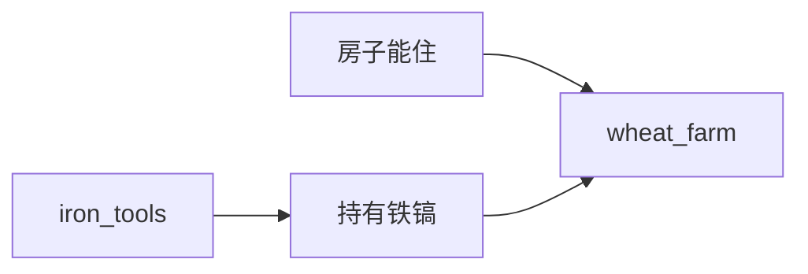

# Minecraft Core 重构设计

2026-11-22，主人已同意方向和顺序。审核：Claude；实现：Codex，按轮次交付。
上位文档：`docs/minecraft-autonomy-roadmap.md`。主线目标和「做完」标准不变，本文件只改 Core 怎么做到。

> 第 3、6 节的数字已按 R1 报告核对为 `489b86d` 的准确值（2026-11-23）。

## 1. 为什么要重构

`c709f75` 之后连续七轮修补，第 1 步仍未通过。底层动作基本可靠：寻路、放置、挖掘、床上自救、过桥，十四个定点都能过。问题出在动作之上的处理层：

- 各层自己记失败、自己定优先级、自己判断卡住，规则重叠。几乎每一轮的 bug 都出在两层的交界处。
- 修补只加不并。14 个提交里 Core 新增 4,435 行，只删了 629 行。很多注释写的是「某次某个 Bot 出了什么事」，像一本事故手册。
- 验证太慢。每轮要跑 3 组 × 90 分钟，换一个世界就会撞上新的长尾情况。Bot 自己不知道自己卡住了，只能靠事后审计脚本发现。

这是之前「每轮看一个症状、修一个症状」的方式造成的，不是某一处代码写错。所以本轮不再按症状打补丁，按结构重构。

## 2. 原则

1. **Core 要强，LLM 用得越少越好。** 平时完全由 Core 自己跑。每 8 小时叫了几次 LLM，是 Core 健康度的指标之一。
2. **doctor 负责发现卡住。** doctor 读 Bot 自己的事件流，发现卡死、死循环、长时间没有进展时，先让 Core 自救，不行再叫 LLM，最后报告主人。doctor 自己不控制身体。
3. **每个概念只有一个负责的地方。** 失败记忆、夜间、材料、卡住判定，各一处。
4. **每一轮都要合并或删除东西。** 报告里写 Core 净行数，以及每个概念现在由几处负责。
5. **先能测量，再改行为。** 第一轮只加检测和离线回放，不改 Bot 的任何行为。

## 3. 现状问题与证据

行数和处数是 2026-11-22 读 `489b86d` 得出的，动手时以实际代码为准。

| # | 问题 | 证据 | 计划在哪一轮 |
|---|---|---|---|
| P1 | 卡住只有事后审计能发现 | 判定卡住的逻辑有四处：`self-stuck.js`、`recovery.js` 的 `unstick`、`brain.js` 的 `noProgressLimit`、`home_escape`。真正可靠的「5 分钟静止」来自外部的 `stationary-audit.py`。水边 9.5 分钟、墙缺一格 32 分钟、岸边绕 11 分钟，Bot 内部都没发现。 | R1 检测，R5 处置 |
| P2 | 材料规则写在三处 | `starterHouse.js:41` 墙写死圆石，`:51` 屋顶写死木板；`knowledge.js` 有 `shelter_wall`、`cave_wall`、`roof_*`；`homestead.js:73` 有 `roofFallbackMatches`。种子 2 身上有 56 块砂岩，却为 1 块圆石卡了 32 分钟。 | R2 |
| P3 | 动作失败没有统一格式 | 451 种失败原因（439 个静态值、12 个模板）。附加标志各层自己判断：`sourceHandled` 48 处、`waited` 94 处，还有 `destinationUnconfirmed` 6 处、`handedOff` 7 处。`target-memory.js` 自带一份忽略清单，`tryHomeTarget` 一次查四个标志。 | R3 |
| P4 | 失败记忆有五套 | `blacklist.js`（2 分钟，还被拿来存「刚回过家」「床放过了」这类标记）、`target-memory.js`（30 分钟、3 次排除）、办法梯的区域教训（30 分钟）、`brain.js` 行为冷却（2–30 秒）、director 冷却和让出。原木没进目标记忆、健康目标被排除、被困时排除目标，都是它们交接出的错。 | R3 |
| P5 | 优先级是固定档位加例外钩子 | `brain.js` 先比档位再比分数：任务固定 50，13 个维护类行为都在 100。例外越加越多：`yieldTo` 7 处、`stepBlocked`、`provisionScope`。`17320ee` 又加了档位 51 的 `dusk_home`，还在 `brain.js` 里加了岸边钩子 `shoreAdapt`。傍晚和夜间有五处在处理。「顺手打猎」把种子 2 带离家 125 格。 | R4 |
| P6 | 办法梯和其他层重叠 | 9 条梯。`goal` 梯和 director 让出重复；`route` 梯、`shore-route.js`、区域教训三者重叠；木材梯每次从第一档重来。 | R5 |
| P7 | 下界和末地混在共享代码里 | 约 7,300 行。`recovery.js` 里有判断下界之旅的特例，`endHazards` 总是加载。 | R6 |
| P8 | `homestead.js` 单文件 2,131 行 | 建造、备料、夜间、维护、失败处理混在一起。 | R2–R4 做完后自然拆分 |

刷物品机、各种农场、刷石机等主世界内容**保留**，不在精简范围内。

## 4. 目标架构

```
            主人聊天 ──► LLM（理解指令，下任务）◄── doctor 二级唤醒
                              │                       ▲
                              ▼                       │
  director（没有主人任务时选任务卡） ──► 任务层（homestead、farm、outfit…）
                              │                       │
                              ▼                       │ 事件流
                        执行层（动作）──── 统一结果 ────┤
                              │                       │
  保命层（固定最高）  维持层（统一紧急度）              │
                              │                       │
                         失败账本 / 世界记忆 ──────────┘
```

### 4.1 保命层（固定档位）

被打、怪物近身、溺水、岩浆、着火、窒息、掉落，以及血量或饥饿到危险线。这一层按固定高档位立刻接管，规则和现在的 `escape`、`defend`、`breathe` 等一样。危险线写成一张表，各行为共用。

### 4.2 维持层（看情况算紧急度）

吃饭、补食、回家、过夜、穿甲、整理背包。不再各自用固定档位比较，而是由**同一个紧急度函数**算分。输入：

- 食物、血量；
- 离天黑还有多久；
- 离家多远；
- 当前任务还剩多少工作量。

任务可以报告「还差几步、材料是否齐」，维持层据此决定等不等它。夜间只由一个模块负责：回家、上床，回不去就就地挖洞。「顺手」打猎、挖矿改成任务执行中的小动作，带预算：路线附近、几秒以内、确实缺这样东西、不在傍晚。它不再作为能抢走身体的独立行为。

### 4.3 任务层与 director

任务卡和 director 保留。director 只负责「没有主人任务时选哪张卡」，不再管失败计数和冷却：失败计数归失败账本，卡住归 doctor。

R4 补充（2026-11-24，主人提议）：卡片分值不再是定值，而是**同一个价值函数**根据当前处境算出来的。
- 分项：
  - 基础重要度：它能解锁多少后续卡；
  - 就绪度：材料够不够，账本里有没有被挡住；
  - 代价：从当前位置和从家出发的路程，离天黑还有多久，风险（水下、深处、附近刚死过）；
  - 已有进度：少量加分。
- 防抖：正在做的卡有黏性，挑战者要高出一定比例才换；只在步骤边界和固定间隔重新评分。
- 封顶：一张卡长时间没有步骤或里程碑进展，价值逐步衰减。
- 每次选择都记录各分项，回放能解释「为什么选它」。
- 维持层的紧急度函数（第 4.2 节）与它用同一套输入。保命层仍是固定档位。

R4.1 补充（2026-11-24，R4 自然跑的教训）：
- **「进展」只看真实工作量。**卡片 `work()` 的剩余量下降、就绪度上升，或者出现里程碑，才算进展。步骤返回的 `progress:true` 只给动作重试和办法梯用。R4 里探索段和矿道段都返回成功，卡片衰减从来没触发过。
- **每个循环都要有会停的计数器。**
  - 同一步骤反复 `start` 失败，到上限后升级为 `target`；
  - 搜索办法返回 `complete(false)` 也累计段数和距离；
  - 办法用尽后走备用材料。
- **以家为中心的半径**适用于所有任务层的探索，比如农场、找木、找羊。距离从家量起，不从 Bot 当前位置量起。
- 依赖图：`wheat_farm` 的前置是「能住 + 铁镐」，不再要求铁剑和盾。

R4.2 补充（2026-11-24，R4.1 自然跑的教训）：
- **卡片前置条件只写世界和库存的状态，不写身体状态。**血量、饥饿交给保命层、维持层和价值函数里的身体风险扣分。
- **救援之间不能互相抢。**脱困本身就是救援档，自带换气；只有气量到临界时才让换气抢占。脱困办法梯最后要有「挖出去」和「柱子上去」。
- **过夜办法梯：**来得及就回家，地下也一样；来不及就 `digIn`；`digIn` 不行就原地围起来；再不行就告警并原地防守。
- 任务层的所有探索，包括储备卡和搬迁，都有以家（或出生点）为中心的距离预算。

R4.3 补充（2026-11-24，R4.2 自然跑的教训）：
- **定址前的锚点跟着 Bot 走。**还没有房子时，探索原点是当前的搬迁锚点，不是出生点；身在范围外时，先走回范围内。
- **掩蔽状态每次按方块重新算，**不用锁存的标志。人还被困着时，不能「先做别的事」。
- **失败结果要带能读懂的 `facts`。**不能是空的 `{}`，也不能放 mineflayer 对象。
- **新功能替换旧代码，不叠在旧代码上。**每轮先单独交一个只删不改行为的提交。

**路线调整（2026-11-24）：**
- R3 到 R4.2 最难修、补丁最多的都在**判断层**：
  - 价值函数的 `stale`、迟滞和退避（R4.2 种子 1 持有前后分数差了 56 分）；
  - 卡片的 `requires`；
  - 办法梯；
  - 搬迁和选址的兜底（R4.2 种子 2 放宽的不是真正的拒绝原因；种子 1、3 选了平地房，没赶上第一次天黑）。
- 手写规则越补越多。所以，R4.3 只修手脚和反射，判断层不再加规则。
- 随后做一次 **A/B 实验**：
  - 由低频调用的模型来当 director，从固定的技能菜单里选下一步，参数经过校验；
  - 保命、过夜、安全规则、失败账本和 doctor 都留在本地；
  - 判断标准事先定好：里程碑不差于手写版，安全零计数为 0，每小时调用不超过 120 次，删除试验净减至少 1,500 行。
- 如果采用：
  - 第 4.3 节的价值函数和卡片调度、各办法梯、第 4.9 节「只在 doctor 二级唤醒时调用」这几条规则，都改为由模型 director 负责；
  - R5 的「办法梯收缩」改成删除判断层。
- 选择这条路而不是 computer use，原因有三：
  - Minecraft 需要零点几秒的实时反应，截图加推理一次就要几秒；
  - 每一步都带截图，token 消耗高出几个数量级；
  - 画面不如服务端坐标和逐格核对准确。

R4.3.1 补充（2026-11-24，R4.3 `4b00073` 的教训）：
- **「到了」和「完成」只用一个定义。**出坑的目标高度和「已经出坑」的判断必须是同一个条件（坑外能站的一格），否则梯子会一直在差一格的地方循环（种子 2 出井 68 次）。
- **重试必须和上次不一样。**同一个场景里，起点、目标、办法、结果都相同的尝试不做第二次。
- **反射的成功要按结果核对。**`escape` 只看 goTo 结束就算成功，矿道里连跑 9 次后死亡；跑不掉要有后手（堵、垫、围、反击）。
- **一次技能调用做完一件完整的事。**采种子一次只拔一株草，拖慢的是所有调用方，将来的模型 director 也一样。
- **定点只断言物理结果和服务端事实，**不断言判断层的遥测，这样换了 director 定点照样能用。
- **代码量从 R4.3.1 起按 Acorn token 计，**代码行只作报告。R4.3 行数减了 202，token 只减了约 0.5%，一部分减法来自把多行合成一行。
- A/B 实验的 A 组改用 R4.3.1 的自然跑，A、B 两组用同一个提交。



### 4.4 执行层的统一结果

每个动作结束时返回同一种结构：

```js
{ ok: true }                                  // 完成
{ ok: false, kind, reason, facts }            // 失败
// kind：
//   'target'       目标本身有问题（这棵树走不到）
//   'start'        起点有问题（自己在水里、被困、在自救）——永远不记到目标头上
//   'material'     缺料：facts = { need: {...}, carried: {...} }，调用方可以直接换料
//   'interrupted'  被抢占或取消
//   'environment'  天黑、区块未加载、服务器拒绝等
```

旧的原因字符串通过一张「原因 → 分类」对照表转过来。附加标志逐步删除。

R3 补充（2026-11-23）：
- 合理等待单独一种形状 `{ ok: true, wait: { reason, until } }`，取代 `waited` 标志；
- 完成可带 `progress: false`；
- 失败带 `attemptId`，贯穿规划、执行、确认和重试，重试前重读目标和库存；
- 对照表必须覆盖全部原因，表外原因在单测里直接失败。

R3.1 补充（2026-11-23）：`start` 是相对的，取决于结果交回给谁。
- 任务、采集、建造等调用方遇到身体出不去，记为 `start`：不记账，卡片冷却也不加码。
- 自救行为（`home_escape`、`unstick`、出坑、出水等，清单集中在一处）内部的失败保持原分类：照常退避，自己的办法梯照常换档。这些失败只记在自救自己的用途下，不能排除工作目标，也不能烧掉通往工作目标的路线梯。
- 与分类无关的空转上限：同一行为短时间内失败过多，就必须退避。

R3.2 补充（2026-11-23）：`start` 看出发时，不看失败时。
- 尝试开始时身体就有问题（已经在水里、被困、首步失效），才算 `start`。出发时好好的，走这条路线把身体带进水里，这是路线的错，记为 `target`。
- 上一次朝目的地 X 走进了水，这一次从这片水朝 X 出发又失败，也算 X 的路线失败。出发时的「水」就是 X 的路线造成的。
- 卡片自己的通用办法梯只在「上一步成功以来」连续失败时才升档。中间任何一步成功，连续计数清零。
- 非自救行为的 `start` 失败也要等一个短暂的固定间隔，不升级，也不计入卡片冷却。

### 4.5 失败账本（替代五套记忆）

- 一本账，键是「什么东西 + 在哪里」：具体方块、实体或区域。
- 只记 `target` 类失败。`start` 类和自家范围、玩家方块一律不记，这两条是硬规则。
- 有效期和排除次数按失败分类写在一张表里。
- 接口：`record(result, target)`、`skip(target)`、`regionHard(region)`、`clearOnSuccess(target)`。
- 「刚回过家」「床放过了」这类状态标记搬回各自的模块，不进账本。
- R3 补充（2026-11-23）：账本合并四套目标级记忆，即 `blacklist`、`target-memory`、办法梯区域教训（含 `hard_route`）和 director 的 `blockedSteps`。
  - `brain.js` 行为冷却和 director 卡片冷却属于调度退避，不进账本，R4 时和三层优先级一起处理。
  - 本轮只要求这两处读结果的 `kind`：`start`、`interrupted`、`wait` 不加码。

### 4.6 材料表

- 蓝图每一格只写用途：墙、屋顶、地板、家具。
- 一张表规定每种用途接受哪些方块、按什么顺序优先，例如墙：圆石 → 石头类 → 深板岩圆石 → 砂岩 → 红砂岩 → 泥土。
- 每种用途分首选组和退路组。首选组内任何一种都算合格，先用身上已有的（含就地可合成的，如 4 沙 → 砂岩）；退路组只在获取首选已经失败时才用，不因「去采要花时间」提前用。
  - 墙：首选圆石、石头类、深板岩圆石、砂岩、红砂岩；退路泥土。已落成的墙格从不拆。
  - 屋顶：首选木板；退路为墙的首选组再到泥土。退路格由「屋顶换木」维护换回木板，只换 Bot 自己放的。
  - 填块、封顶：一组实心不下落的方块，替代各处散落的 `FILLERS` 清单。
  - 主人已同意墙和屋顶都可以替代；家具照旧要求木料；现有保留量规则照旧。
- 屋顶换回木板的维护读同一张表。

### 4.7 doctor

doctor 在 Core 进程内运行，只读事件流和观测采样，不控制身体。它分三级：

| 级别 | 触发 | 动作 |
|---|---|---|
| 检测 | 见第 4.8 节的规则 | 发出 `doctor_alert` 事件，写进状态，附摘要和证据 |
| 一级 | 告警持续 | 调用 Core 现有的自救或换任务（R5 才启用） |
| 二级 | 一级无效 | 把状态摘要交给 LLM，从固定菜单里选：放弃这个目标、换址、回家、换任务、问主人（R5 才启用） |
| 三级 | 二级无效或有风险 | 通过 DeskPet 现有的 doctor 用 QQ 报告主人（R5 才启用） |

### 4.8 doctor 检测规则（R1）

都来自已发生的真实案例，每条规则要和 `stationary-audit.py` 保持一致，或说明哪里不同、为什么：

- **D1 原地不动**：一段时间内水平位移很小。合理等待要排除：夜里挖洞、在床上、夜里在家、跟随主人而主人没动、测绘任务。2–3 分钟发预警，5 分钟发告警。
- **D2 同一失败反复出现**：同一个失败原因，在同一格或同一片区域，短时间内出现 K 次。例如水边 `path_timeout`、墙角格 `no_material`。
- **D3 计划步骤空转**：同一个计划步骤反复发出，对应的背包数量或方块状态没有变化。例如为墙「采 1 块圆石」，半小时没采到。
- **D4 地点循环**：不同行动之间反复回到同一小组位置。例如岸边那几处、换区时的四个路点。
- **D5 长时间没有进展**：白天、非等待状态，X 分钟没有新里程碑，也没有完成任何一个计划步骤。
- **D6 傍晚离家越来越远**：已经定址，傍晚时离家距离还在增加，或者天黑时离家超过阈值。
- **D7 空闲**：没有任务在跑、director 在等重试，超过 2 分钟。
- **D8 任务来回切换**：同一张卡在一段时间内被选中又让出 N 次。

告警格式：

```js
{ type: 'doctor_alert', rule: 'D2', severity: 'warn'|'alert', since, at,
  summary: '在 (251,74,-39) 放墙 no_material 已 5 次，身上有砂岩 56、圆石 0',
  evidence: [/* 事件序号或时间 */], context: { card, goal, step, position, home, timeOfDay } }
```

`summary` 和 `context` 以后就是二级唤醒时交给 LLM 的输入，所以从 R1 起就要写成能直接读懂的句子。

### 4.9 LLM 的角色

- 主人聊天 → LLM → Core 工具：保持现状。
- 自主发育中：只在 doctor 二级唤醒时调用，只能从固定菜单里选，不能直接下底层指令。
- 不能碰主人方块、不能进下界这类安全规则留在执行层，LLM 改不了。

## 5. 分轮计划

每一轮都沿用：作者和提交者 `Louis Jia <louisjia2008-ux@users.noreply.github.com>`；不 push、不安装、不连主人的世界；不用 `/tick sprint`；公开仓库，提交前做隐私检查。

| 轮 | 内容 | 行为是否改变 | 验收 |
|---|---|---|---|
| **R1** | doctor 检测（只告警）+ 离线回放工具 + 历史案例标注 | 不改变 | 离线回放命中全部已标注案例，正常段零误报；实服跑一组确认告警能实时发出 |
| R2 | 材料表 | 改变（换料） | 材料单测；种子 1、3 外观不变；种子 2 不再出现「有料却去采」；回放无新增告警 |
| R3 | 统一结果 + 失败账本 | 改变 | 历次交接案例全部写成单测；五套记忆减到一套；14 个定点；三种子 90 分钟门槛 |
| R4 | 保命、维持、任务三层；夜间合一；「顺手」带预算 | 改变 | 傍晚和补食单测；夜间处理减到一处；种子 2 能住 ≤ 60 分钟；三种子门槛 |
| R5 | doctor 一、二、三级处置；办法梯收缩；删 `goal` 梯；岸边并入路线梯 | 改变 | 回放里每个案例都能在规定时间内脱困；8 小时内 LLM 调用次数有上限；3 × 8 小时长跑 |
| R6 | 下界、末地拆成独立模块，共享代码里的特例移走 | 不改变主世界行为 | 主世界回归不变；下界、末地原有测试照过 |

R2 起每轮都要报告第 6 节的指标。第 1 步的门槛（能住、铁工具、完工、零退步、零静止等）照旧，R3 起每轮都要跑三种子 90 分钟。

## 6. 指标

| 指标 | 现状（`489b86d`） | 目标 |
|---|---:|---|
| Core 总行数 | 27,922（`489b86d`，98 个 JS 文件；R1 后 29,230，R3 后 29,748） | 到 R5 结束时，不含 doctor 的 Core ≤ 27,922；每轮报告净变化和离预算的差距。R4 起另报「代码行」（不含注释、空行），以它为准，`489b86d` 的代码行基线由 R4 重新测量；删注释不算减法 |
| 失败记忆的套数 | 4 目标级 + 2 调度退避 | 目标级 1（R3）；调度退避 1（R4） |
| 傍晚和夜间的处理处数 | 5 | 1 |
| 材料规则的处数 | 3 | 1 |
| 卡住判定的处数 | 4 + 外部审计 | doctor 1 处 |
| doctor 告警（每小时） | — | 每轮报告，逐步下降 |
| 每 8 小时 LLM 调用次数 | — | R5 起报告，越少越好 |

## 7. 基线与分支

- 「重构前」基线：`489b86d`，批次 `water-wood-roof-b`。三种子 90 分钟完整证据都在输出目录。
- `17320ee`、`1af349c`（墙料、傍晚、岸边补丁）没有完成验证，**不合入**重构分支，只作参考。其中的墙料和傍晚逻辑由 R2、R4 按新结构重做。
- 重构分支从 `489b86d` 开出：`codex/core-refactor-20261122`。
- 历次自然跑的日志保存在本机的输出目录，用于离线回放。日志不进仓库。

## 8. 历史案例（R1 标注的起点）

时间是跑动开始后的分:秒。以报告对应章节为准，有出入时先核对再标注。

| # | 批次 / 种子 | 时间 | 现象 | 应命中的规则 |
|---|---|---|---|---|
| 1 | `plants-relocation-b-seed-1` | 1:13:30–1:23:00 | 水边回家反复 `path_timeout`，静止 9.5 分钟 | D1、D2 |
| 2 | `water-wood-roof-b-seed-2` | 27:30–59:47 | 墙角 `(251,74,-39)` `no_material` 多次，身上有砂岩 | D2、D3 |
| 3 | `water-wood-roof-b-seed-2` | 29:43–30:55 | 傍晚 `dusk_home` 被补食抢走，在离家约 125 格外挖洞 | D6 |
| 4 | `water-wood-roof-b-seed-3` | 72:35–83:26 | 岸边换路在不同行动之间反复，`exhausted` 三次 | D4 |
| 5 | `plants-relocation-b-seed-2` | 约 28:11–1:20:54 | 屋顶缺木板，同两根原木反复被选中，始终不能住 | D2、D3、D5 |
| 6 | `torch-target-c-seed-1` | 约 0:04–0:33、0:44–1:30 | 床上卡住，醒来困在死角 | D1 |
| 7 | `self-trap-a-seed-1` | 见报告「自困与完工备料」 | 主卡冷却、其他卡被阶段挡住，空闲约 27 分钟 | D7 |
| 8 | `self-trap-a-seed-3` | 约 71:42–72:28 之后 | 路线梯 46 秒烧完，在自家门口记下区域教训 | D2、D4 |
| 9 | `full-run-a-seed-2` | 6:16–10:21 | 换区时在约 20 格半径内绕四个路点 | D4 |
| 10 | `failure-owner-a-seed-2` | 10:58–19:06 | 建家卡夜里约每 54 秒被选中又让出，共 10 次 | D8 |

正常段（用来测误报）：`water-wood-roof-b-seed-1` 全程（5:52 的死亡和重生除外）、`water-wood-roof-b-seed-3` 0–70 分钟、`plants-relocation-b-seed-3` 全程。Codex 可以按日志补充更多案例和正常段，但要在报告里列出依据。
